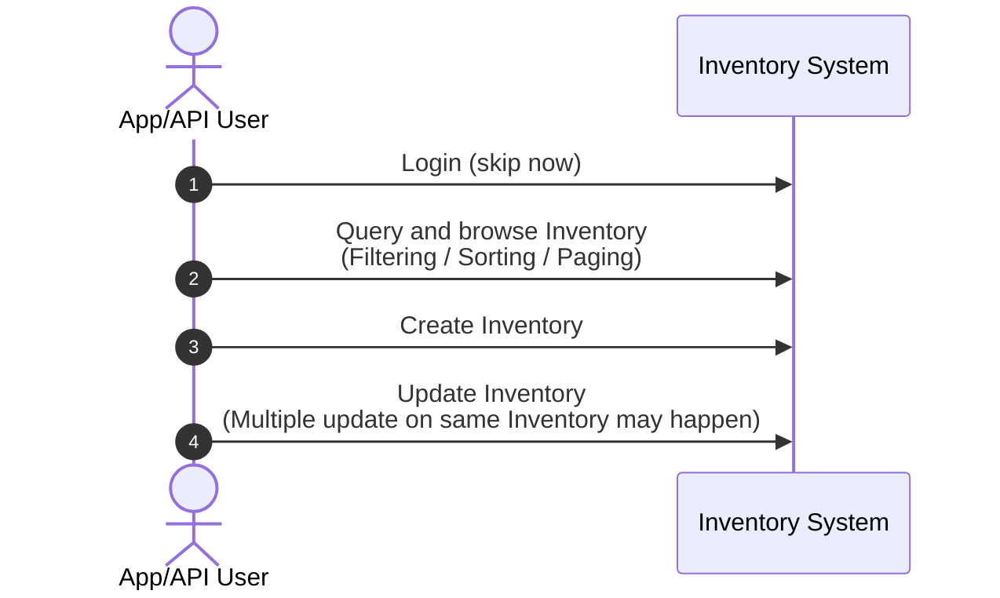

# Simple Inventory Demo

- [1. User Journey](#1-user-journey)
- [2. Assumption and Decision](#2-assumption-and-decision)
  - [2.1 Business](#21-business)
  - [2.2 Technical](#22-technical)
- [3. Target](#3-target)
- [4. API and Error Code Notes](#4-api-and-error-code-notes)
  - [4.1 General API Request](#41-general-api-request)
  - [4.2 General API Response](#42-general-api-response)
  - [4.3 API](#43-api)
  - [4.4 Error Code and Message](#44-error-code-and-message)
- [5. Schema](#5-schema)
  - [5.1 Category](#51-category)
  - [5.2 Inventory](#52-inventory)
- [6. Development Environment](#6-development-environment)
- [7. How to Run](#7-how-to-run)
  - [7.1 Prerequisites](#71-prerequisites)
  - [7.2 Build and Start](#72-build-and-start)
  - [7.3 Health Check](#73-health-check)
  - [7.4 API Examples](#74-api-examples)
  - [7.5 Notes](#75-notes)

## 1. User Journey


## 2. Assumption and Decision
### 2.1 Business
1. Skip user authentication 
    - no login and JWT / session generation and verification (for app/web access)
    - no key id / secret and HMAC generation and verification (for direct API access)
2. Skip user authorization
    - suppose user can take ALL actions on ALL data
    - no user / role / permission tables 
3. Skip audit tables
    - if needed, consider to add triggers on related table and create audit tables and purge jobs
4. Suppose _Category_ (and also _Sub-category_) will be created and existed BEFORE creating _Inventory_
5. One Inventory ONLY belongs to one category and sub-category
6. Skip category / sub-category / inventory activation and deactivation
    - all category / sub-category / inventory are active can be accessed
    - if needed, introduce state and verification logic on related operations
7. Skip category / sub-category / inventory deletion
    - if needed, consider soft deletion by setting a flag or hard deletion
8. Inventory quantity is non-negative integer
   - if it is decimal, consider all the data type and handling through API input / output, processing logic to database storage
### 2.2 Technical
1. Simply use sync http call
    - the bottleneck would be the database connection pool, not the webserver connection capacity
2. Simply use java in-memory database (H2) for demo (and also for testing)
3. Skip deployment as written in the doc
   - if needed, consider directly deploy the jar, or consider docker (plus k8s, etc)
   - even load balancer for scale up 
4. Not a priority by now to especially pursue low GC and low latency
5. Skip in memory cache and directly query database for data
6. For database
   - Only necessary columns
   - For time, simply choose big integer to store milliseconds
   - Business logic need to follow this contract

## 3. Target
Build a running version under the assumptions and also a skeleton for extension
- ✅ **v1**: three functions with proper error code and test
- **v2**: logging and elapsed time
- **v3**: query filtering, sorting and paging

## 4. API and Error Code Notes
For simplicity, put the requestId in body instead of header "X-Request-ID"

### 4.1 General API Request
```json
{
   "requestId": "cln-123",
   "params": {
     // per request
   }
}
```

### 4.2 General API Response
```json
{
   "requestId": "cln-123",
   "code": 0,
   "message": "success",
   "data": ...
}
```

### 4.3 API
| #  | Url               | Method | Notes                                                                                                                       |
|----|-------------------|--------|-----------------------------------------------------------------------------------------------------------------------------|
| 1  | /inventory/query  | POST   | Return a list of inventories, blank array for nothing                                                                       | 
| 2  | /inventory/create | POST   | Return the new created inventory; craetedBy hardcode to 'admin' in backend                                                  |
| 3  | /inventory/update | POST   | Only update quantity; updaetdBy hardcode to 'admin' in backend; use version for optimized lock and return the new inventory |

### 4.4 Error Code and Message

Business and validation failures use HTTP 200 with a non-zero application code.
Protocol errors use HTTP 400, and unexpected failures use HTTP 500.

| Error Code | HTTP Status | Error Message                          | Notes                                              |
|------------|-------------|----------------------------------------|----------------------------------------------------|
| 0          | 200         | `success`                              | Success                                            |
| 1000       | 200         | `invalid request: <detail>`            | Parsed request failed validation or has a conflict |
| 1001       | 200         | `inventory <id> not found`             | Requested inventory does not exist                 |
| 1002       | 200         | `inventory name '<name>' already exists` | Duplicate inventory name                         |
| 1003       | 200         | `invalid category: <detail>`           | Category or sub-category is invalid                |
| 1004       | 200         | `version conflict`                     | Optimistic locking version conflict                |
| 1005       | 400         | `invalid request body`                 | Missing or unreadable JSON request body            |
| 9999       | 500         | `system error`                         | Unexpected system failure                          |


## 5. Schema
### 5.1 Category
*Sub-Category* is a Category with parent_id

| Column            | Type         | Notes             |
|-------------------|--------------|-------------------|
| ID                | int          | Key               |
| PARENT_ID         | int          | Nullable          |
| NAME              | varchar(255) | Unique constraint |
| VERSION           | int          |                   |
| CREATED_BY        | varchar(255) |                   |
| CREATED_AT_UTC_MS | bigint       |                   |
| UPDATED_BY        | varchar(255) | Nullable          |
| UPDATED_AT_UTC_MS | bigint       | Nullable          |

### 5.2 Inventory
| Column            | Type         | Notes              |
|-------------------|--------------|--------------------|
| ID                | int          | Key, auto increase |
| NAME              | varchar(255) | Unique constraint  |
| CATEGORY_ID       | int          | Foreign key        |
| SUB_CATEGORY_ID   | varchar(255) | Foreign  key       |
| QUANTITY          | int          | Unique constraint  |
| VERSION           | int          |                    |
| CREATED_BY        | varchar(255) |                    |
| CREATED_AT_UTC_MS | bigint       |                    |
| UPDATED_BY        | varchar(255) | Nullable           |
| UPDATED_AT_UTC_MS | bigint       | Nullable           |

## 6. Development Environment

| Item                        | Value                                    |
|-----------------------------|------------------------------------------|
| OS                          | Windows 10 Pro                           |
| JDK                         | Temurin JDK 21.0.12                      |
| Maven                       | Apache Maven 3.9.11                      |
| Java compilation target     | Java 17 (`<release>17</release>`)        |
| Spring Boot                 | 4.1.2                                    |
| Spring Data JPA / Hibernate | Hibernate 7.4.13.Final                   |
| Database                    | H2 2.4.240, in-memory                    |
| Connection pool             | HikariCP, fixed size 10                  |
| Tests                       | JUnit Jupiter, AssertJ, Mockito, MockMvc |

The project is built and tested with JDK 21, but the compiler produces Java 17 bytecode.

Build and run the full test suite with:

```bash
mvn clean verify
```

## 7. How to Run

### 7.1 Prerequisites

| Item                | Requirement                                                     |
|---------------------|-----------------------------------------------------------------|
| Java                | JDK/JRE 17 or newer                                             |
| OS                  | OS-independent; tested on Windows 10                            |
| Database            | H2 in-memory; no external database required                     |
| HTTP port           | 8080 by default; override with `--server.port` or `SERVER_PORT` |
| Packaging           | Executable Spring Boot jar                                      |

### 7.2 Build and Start

First, build the executable jar. By default, Maven also runs the test suite:

```bash
mvn clean package
```

To skip tests when building the jar:

```bash
mvn clean package -DskipTests
```

The jar is created at:

```text
target/dennis-inventory-demo-0.0.1-SNAPSHOT.jar
```

Start the application with:

```bash
java -jar target/dennis-inventory-demo-0.0.1-SNAPSHOT.jar
```

Alternatively, run it directly with Maven during development:

```bash
mvn spring-boot:run
```

Override the port:

```bash
java -jar target/dennis-inventory-demo-0.0.1-SNAPSHOT.jar --server.port=18080
```

### 7.3 Health Check

```bash
curl http://localhost:8080/actuator/health
```

### 7.4 API Examples

> **Windows users:** The `curl` examples below use Bash quoting and line continuations. Run them in **Git Bash** on Windows. Using `cmd.exe` or PowerShell may require different quoting and escaping.

The examples below assume the application is running on port `8080`. All inventory endpoints use `POST` with the common request envelope.

Seed categories:

```text
1 Food
2 Clothes
3 Cake (parent 1)
4 Shoe (parent 2)
5 T-Shirts (parent 2)
```

#### Query

```bash
curl -sS -X POST http://localhost:8080/inventory/query \
  -H 'Content-Type: application/json' \
  -d '{"requestId":"q-1","params":{}}'
```

#### Create

```bash
curl -sS -X POST http://localhost:8080/inventory/create \
  -H 'Content-Type: application/json' \
  -d '{
    "requestId": "c-1",
    "params": {
      "name": "Chocolate Cake",
      "categoryId": 1,
      "subCategoryId": 3,
      "quantity": 10
    }
  }'
```

The created inventory is returned with its generated `id` and initial `version = 0`. On a fresh H2 database the first inventory normally has `id = 1`.

#### Query After Create

```bash
curl -sS -X POST http://localhost:8080/inventory/query \
  -H 'Content-Type: application/json' \
  -d '{"requestId":"q-2","params":{}}'
```

#### Update Quantity

```bash
curl -sS -X POST http://localhost:8080/inventory/update \
  -H 'Content-Type: application/json' \
  -d '{
    "requestId": "u-1",
    "params": {
      "id": 1,
      "version": 0,
      "quantity": 8
    }
  }'
```

A successful update increments `version` from `0` to `1`.

#### Stale Version

Reusing an outdated version must fail with code `1004`:

```bash
curl -sS -X POST http://localhost:8080/inventory/update \
  -H 'Content-Type: application/json' \
  -d '{
    "requestId": "u-stale",
    "params": {
      "id": 1,
      "version": 0,
      "quantity": 5
    }
  }'
```

Expected response:

```json
{
  "requestId": "u-stale",
  "code": 1004,
  "message": "version conflict",
  "data": null
}
```

#### Duplicate Name

```bash
curl -sS -X POST http://localhost:8080/inventory/create \
  -H 'Content-Type: application/json' \
  -d '{
    "requestId": "c-dup",
    "params": {
      "name": "Chocolate Cake",
      "categoryId": 1,
      "subCategoryId": 3,
      "quantity": 5
    }
  }'
```

This returns code `1002`.

#### Invalid Category Selection

```bash
curl -sS -X POST http://localhost:8080/inventory/create \
  -H 'Content-Type: application/json' \
  -d '{
    "requestId": "c-badcat",
    "params": {
      "name": "Loaf Cake",
      "categoryId": 1,
      "subCategoryId": 4,
      "quantity": 5
    }
  }'
```

This returns code `1003` because sub-category `4` belongs to Clothes, not Food.

#### Missing requestId

```bash
curl -sS -X POST http://localhost:8080/inventory/query \
  -H 'Content-Type: application/json' \
  -d '{"params":{}}'
```

This returns HTTP 200 with code `1000`.

#### Malformed JSON

```bash
curl -sS -X POST http://localhost:8080/inventory/query \
  -H 'Content-Type: application/json' \
  -d '{'
```

This returns HTTP 400 with code `1005`.

Note that business and validation errors use HTTP 200. Inspect the response body's `code`; only malformed JSON uses HTTP 400, and unexpected server errors use HTTP 500.

### 7.5 Notes

- Spring Boot 4 requires Java 17 or newer; Java 11 is not supported.
- H2 data is reset when the application restarts because `schema.sql` and `data.sql` are re-executed on each application start.
- No external database, Docker, or Kubernetes setup is required for this demo.

